# Plan del módulo de seguidores de Instagram

Fecha de investigación: 15 de noviembre de 2026.

El módulo será una herramienta interna de ICM, integrada en icmSpy y utilizada por su equipo autorizado. Permitirá pegar la URL de un perfil de Instagram, obtener los seguidores que la fuente entregue, consultar sus perfiles públicos y recuperar los correos y teléfonos que publiquen. El resultado será una audiencia consultable y exportable, con procedencia, fecha de observación y límites visibles.

La recomendación es empezar con un proveedor de extracción intercambiable y mantener en icmSpy la ejecución, los datos, la normalización, los filtros y la exportación. La primera entrega debe ser un piloto de cobertura y costo. Una interfaz completa no resolvería una fuente que devuelve pocos seguidores o casi ningún contacto útil.

La investigación documental y el diseño están terminados. La cobertura real, la velocidad y el rendimiento comercial de los proveedores requieren ese piloto; no se ejecutaron extracciones pagadas ni se accedió a una cuenta de Mailerfind.

El alcance es una sola organización y una cuenta de proveedor administrada por ICM. Se reutilizan el acceso y los roles existentes. No se necesitan planes de clientes, cobros a usuarios, gestión de suscripciones propia ni arquitectura multiempresa. Los límites monetarios sirven para controlar el gasto de ICM en servicios externos.

## Cómo funciona la función de referencia

Mailerfind documenta un análisis que parte de una cuenta, recorre perfiles de sus seguidores y obtiene contactos cuando están publicados. Su ayuda distingue expresamente resultados completos, parciales y sin contacto directo. No necesitas subir un CSV para iniciar ese recorrido. [Análisis de seguidores](https://help.mailerfind.com/en/article/follower-analysis-106et9q/), [funcionamiento de los análisis](https://help.mailerfind.com/es/article/como-funcionan-los-analisis-g916r6/).

El recorrido que debemos reproducir es:

```mermaid
flowchart LR
  A[URL del perfil] --> B[Resolver cuenta y comprobar acceso]
  B --> C[Obtener páginas de seguidores]
  C --> D[Eliminar duplicados por ID]
  D --> E[Consultar perfiles públicos]
  E --> F[Extraer contactos publicados]
  F --> G[Consultar web enlazada si se habilita]
  G --> H[Normalizar y guardar evidencia]
  H --> I[Filtrar resultados y exportar]
```

Este diagrama es la arquitectura propuesta para icmSpy. La documentación pública de Mailerfind describe el comportamiento, pero no identifica su proveedor de datos ni permite confirmar su implementación interna. No hay base para afirmar que usa Apify, una API privada concreta, un conjunto de sesiones o una base de datos propia.

Mailerfind cobra en Instagram por perfil público analizado, aunque no encuentre correo o teléfono. Esto explica por qué procesar una audiencia y obtener una lista de contactos son volúmenes distintos. [Créditos de Mailerfind](https://help.mailerfind.com/es/article/que-son-los-creditos-y-como-funcionan-en-mailerfind-1qvuzef/).

Hay dos supuestos que el producto debe corregir:

- **Un seguidor no necesariamente tiene correo y teléfono públicos.** No se obtiene el correo de registro de Instagram ni su teléfono de recuperación. Un campo ausente debe permanecer ausente.
- **Una lista obtenida no acredita que estén todos los seguidores.** El contador del perfil, la lista entregada por la fuente y los perfiles accesibles pueden diferir. Tampoco seguir a una clínica demuestra ser paciente, profesional de salud o comprador.

## Qué permite la API oficial de Meta

Business Discovery documenta metadatos y métricas de otras cuentas profesionales, incluido `followers_count`. Ese contador no es una lista de identidades. Su paginación de medios tampoco pagina los seguidores. [Business Discovery de Meta](https://developers.facebook.com/documentation/instagram-platform/instagram-api-with-facebook-login/business-discovery).

Meta también documenta Creator Discovery para buscar creadores con filtros y recomendaciones de colaboraciones publicitarias. Requiere elegibilidad y permisos, incluido acceso avanzado sujeto a revisión. Es una alternativa para otro producto, pero no implementa el recorrido «URL de cualquier perfil → sus seguidores → contactos». [Creator Discovery de Meta](https://developers.facebook.com/documentation/instagram-platform/instagram-api-with-facebook-login/creator-marketplace).

Por tanto, las APIs oficiales revisadas no bastan para esta función tal como se solicita. Un servicio externo que anuncie la extracción tampoco demuestra, por ese anuncio, que tenga autorización de Meta para hacerlo.

Meta ha documentado acciones contra la extracción automatizada de perfiles públicos de Instagram sin permiso. Es un antecedente de riesgo operativo y contractual, no una conclusión jurídica sobre un proveedor particular. Antes de activar uno en producción hay que comprobar el uso permitido, las condiciones de almacenamiento y reutilización y la gestión de bajas. [Antecedente publicado por Meta](https://about.fb.com/news/2020/11/combating-clone-sites/).

## Proveedores que documentan las capacidades necesarias

Las siguientes son capacidades declaradas por sus desarrolladores. La recomendación de integración queda condicionada al piloto; no son resultados medidos en cuentas colombianas.

| Opción                                                  | Lista de seguidores                                                                        | Contactos y enriquecimiento                                                                              | Decisión propuesta                                                                             |
| ------------------------------------------------------- | ------------------------------------------------------------------------------------------ | -------------------------------------------------------------------------------------------------------- | ---------------------------------------------------------------------------------------------- |
| Apify, actor mantenido por Apify para seguidores        | Acepta usuario o URL; devuelve ID, usuario, nombre y banderas de privacidad y verificación | El listado no contiene la biografía ni todos los detalles de cada seguidor                               | Candidato principal para enumerar                                                              |
| Apify, actor mantenido por Apify para perfiles          | Recibe perfiles conocidos; no sustituye la enumeración                                     | Biografía, enlaces y datos del perfil; contactos si están en la biografía                                | Candidato inicial para enriquecer; medir cuánto pierde frente a campos de contacto empresarial |
| Data Slayer en Apify, mantenido por la comunidad        | Lista con modos de salida                                                                  | Documenta correo empresarial, correo en biografía, teléfono de contacto, web y estado de enriquecimiento | Comparar como alternativa que reúne las dos etapas                                             |
| Public Signal Labs en Apify, mantenido por la comunidad | Documenta paginación y continuación cuando la fuente la permite                            | Devuelve la lista; requiere enriquecimiento aparte                                                       | Comparar recuperación y continuación; no elegir solo por precio                                |

Fuentes de las capacidades: [listado de Apify](https://apify.com/apify/instagram-followers-following-scraper), [perfiles de Apify](https://apify.com/apify/instagram-profile-scraper), [Data Slayer](https://apify.com/data-slayer/instagram-followers-scraper---no-login), [Public Signal Labs](https://apify.com/publicsignallabs/instagram-followers).

El primer actor diferencia explícitamente listar seguidores de consultar sus perfiles. Data Slayer distingue campos como `public_email`, `biography_email` y `contact_phone_number`; esos campos deberán mantenerse separados en la evidencia. Un resultado enriquecido puede seguir teniendo contactos nulos.

Public Signal Labs reconoce restricciones de cobertura, limita cada ejecución a un máximo solicitado de 20.000 y ofrece un token de continuación solo en determinadas condiciones. Ese token puede caducar y las páginas pueden solaparse entre ejecuciones. No debe confundirse con el identificador de un trabajo o con el desplazamiento de lectura de su dataset.

Las cuatro opciones anteriores usan la infraestructura de Apify; cambiar de actor no elimina una caída de esa plataforma ni una restricción de Instagram. Data365, HikerAPI y SociaVault quedan como candidatos para una comparación posterior: la investigación no estableció un contrato equivalente suficientemente completo de lista de seguidores, contactos, continuación y facturación como para presupuestarlos aquí.

Mailerfind ofrece además un conector MCP que permite iniciar análisis y consultar prospectos con una cuenta y créditos propios. Puede servir para integrar sus análisis en una herramienta interna de ICM si sus condiciones y su acceso técnico lo permiten. Confirmar autenticación de servidor, capacidades, límites y almacenamiento de los resultados: el conector documentado para Claude no acredita por sí solo una API estable para nuestra aplicación. La reventa no forma parte de esta evaluación. [Conector oficial de Mailerfind](https://help.mailerfind.com/es/article/conecta-mailerfind-con-claude-kvkfuk/).

## Alternativas de desarrollo

| Camino                                   | Ventaja                                                                   | Dependencia principal                                                      | Elección                                                  |
| ---------------------------------------- | ------------------------------------------------------------------------- | -------------------------------------------------------------------------- | --------------------------------------------------------- |
| Proveedor de extracción con API          | Reduce el trabajo inicial de adquisición; permite medir resultados pronto | Calidad, disponibilidad, tarifas y condiciones del proveedor               | Empezar aquí, con adaptadores intercambiables             |
| Integrar Mailerfind con la cuenta de ICM | Reutiliza su análisis y organización de prospectos para uso interno       | Acceso técnico, condiciones de uso, créditos y capacidad real del conector | Evaluar si prima entregar rápido sobre controlar el motor |
| Construir un recolector propio           | Más control sobre el código de adquisición                                | Mantenimiento continuo, acceso a la plataforma, restricciones y operación  | Posponer hasta justificarlo con volumen y costo medidos   |
| API oficial de Meta                      | Acceso documentado para los casos admitidos                               | Su alcance no entrega la función solicitada                                | Usarla solo para capacidades que sí cubra                 |

Un recolector propio no es simplemente «abrir Chrome y bajar hasta el final». El listado puede cambiar, truncarse o requerir acceso que no se tiene. El plan inicial no depende de pedir contraseñas o cookies de Instagram a los comerciales ni de eludir restricciones de acceso.

## Piloto que decide la viabilidad

Preparar una herramienta de diagnóstico en el backend, fuera de la interfaz comercial. Debe recibir un perfil, límites y un proveedor; guardar un informe comparable y muestras mínimas de evidencia. Las claves se configuran en el servidor. No iniciar gasto al ejecutar pruebas ordinarias.

Primero, procesar entre 100 y 500 seguidores de una cuenta pública propia o autorizada y de tamaño conocido. Después comparar una audiencia pública de negocios o profesionales con una audiencia más general pertinente al uso comercial de ICM. El primer tramo comprueba el contrato; los siguientes comprueban utilidad. Elegir las cuentas y el presupuesto al ejecutar el piloto, sin inventar URLs de prueba.

Comparar el mismo tramo solicitado con el listado de Apify y con Data Slayer. Probar Public Signal Labs si la continuación del primero no resulta suficiente. Cada llamada tendrá un tope de cobro remoto y un presupuesto total reservado localmente.

El informe debe contener:

| Medida                            | Definición                                                                                                                              |
| --------------------------------- | --------------------------------------------------------------------------------------------------------------------------------------- |
| Seguidores declarados             | Contador de la cuenta y fecha en que se observó; puede estar ausente                                                                    |
| Filas recibidas y usuarios únicos | Duplicados identificados por ID, separados de perfiles sin ID                                                                           |
| Cobertura comprobable             | Comparación por IDs con una referencia propia del mismo momento cuando exista; en cuentas grandes sin referencia, cobertura desconocida |
| Perfiles consultados              | Exitosos, privados omitidos, inaccesibles y errores, con denominadores claros                                                           |
| Contactos recuperados             | Perfiles con correo, con teléfono y con ambos; también valores distintos para no inflar cifras                                          |
| Exactitud de muestra              | Comprobar manualmente 30 contactos, o todos si hay menos; distinguir perfil de web enlazada y terceros                                  |
| Costo real                        | Facturación por etapa, repeticiones, arranques y costo por perfil con contacto útil                                                     |
| Recuperación                      | Reiniciar worker, releer dataset, repetir página y probar continuación sin duplicar datos locales                                       |
| Duración                          | Medida con límites y concurrencia registrados; no extrapolar una promesa de minutos desde la publicidad                                 |

Condiciones técnicas para continuar: evidencia trazable en todos los contactos de la muestra, cero contactos inventados, deduplicación estable y comportamiento comprobado ante reinicio, error y límite de presupuesto. Una sola atribución incorrecta bloquea esa regla de extracción hasta corregirla. La meta de cobertura se evalúa contra la referencia disponible, no contra un porcentaje arbitrario del contador.

La condición comercial es que el costo por contacto útil y el volumen recuperable sirvan para ICM. El piloto debe proponer un umbral con datos; hoy no existe evidencia para fijar una tasa mínima de correos o teléfonos. Si la lista queda muy limitada en las cuentas relevantes, se cambia de fuente o se ajusta el alcance antes de construir toda la interfaz.

## Alcance de la primera versión

Entrada principal: una URL de perfil público o un nombre de usuario. El usuario verá la cuenta resuelta antes de iniciar, fijará un máximo de seguidores a procesar y un presupuesto. Podrá elegir consultar también las webs enlazadas. Se ofrecerá «hasta agotar lo disponible» condicionado al presupuesto, sin prometer un censo completo.

Administración establece los topes globales y por ejecución. Un comercial puede elegir un límite inferior, pero no elevar los topes ni cambiar el proveedor. La interfaz muestra gasto operativo y límites; no contiene compra de créditos ni facturación propia.

El módulo mostrará ejecuciones, progreso por etapa, resultados parciales persistidos, errores y motivo de detención. Permitirá filtrar por texto en nombre, usuario y biografía; presencia de correo, teléfono o web; tipo de cuenta declarado por la fuente; y estado del enriquecimiento. Permitirá exportar los resultados filtrados y los contactos con su procedencia.

La primera versión no necesita IA para extraer un correo visible, interpretar un enlace `mailto:` o reconocer un teléfono con contexto suficiente. La IA puede servir más adelante para clasificación temática; nunca debe completar un contacto por conjetura.

Se aplazan búsqueda por hashtags, comentarios, publicaciones, ubicaciones, mensajes, campañas y sincronización periódica. El diseño permite añadir otros tipos de audiencia después de comprobar el primero. No se mezclan estos seguidores con los prestadores obtenidos de REPS.

## Integración con la arquitectura actual de icmSpy

El repositorio ya tiene Hono, TypeScript, PostgreSQL, Drizzle, pg-boss y React. La API y el worker son procesos separados y comparten contexto. No hace falta añadir Redis, otro backend ni una base de datos distinta para este módulo.

El puerto actual `SourceAdapter` traduce registros a empresas, sedes, códigos de prestador y contactos de empresa o sede. No representa bien una audiencia social. Además, `people` y `contact_points` requieren empresa. Forzar ahí cada seguidor crearía empresas ficticias y contaminaría las búsquedas de salud.

Crear `modules/instagram` con dos responsabilidades de proveedor:

- `FollowerProvider`: resolver la cuenta, iniciar la enumeración, consultar el trabajo remoto y leer páginas de usuarios.
- `ProfileProvider`: enriquecer lotes de perfiles públicos, identificar qué campos están disponibles y devolver contactos con su campo de origen.

Ambos deben declarar capacidades: continuación real, cancelación remota, tope de cobro, tamaño máximo, campos de contacto y fecha o versión del contrato. No fingir que todos ofrecen las mismas garantías. El adaptador traducirá el esquema específico del proveedor al contrato interno, validado con Zod.

Para Apify se usará el inicio de ejecución, su ID remoto y su dataset, con consultas posteriores. Su API documenta `maxTotalChargeUsd`; `maxItems` como parámetro de la API tiene reglas distintas y no sustituye el límite de entrada específico de cada actor. La versión y el esquema exactos se fijarán durante el piloto. [Inicio de ejecuciones](https://docs.apify.com/api/v2/actors-runs-post).

La lectura del dataset admite `offset` y `limit` en orden de incorporación. Guardar el desplazamiento sobre las filas originales; no avanzarlo usando solo los resultados que sobrevivieron a la deduplicación. Evitar transformaciones como `clean` o `unwind` que cambien esa correspondencia durante la importación. Un dataset sin filas nuevas mientras el trabajo sigue activo exige esperar, no declarar la audiencia agotada. [Lectura paginada de datasets](https://docs.apify.com/api/v2/dataset-items-get).

## Datos y procedencia

Usar tablas propias con migraciones aditivas. El número de la migración se toma del estado del repositorio al implementar; actualmente existen cambios de servicios en curso que hay que preservar.

| Tabla propuesta                  | Contenido e invariantes                                                                                                                                            |
| -------------------------------- | ------------------------------------------------------------------------------------------------------------------------------------------------------------------ |
| `instagram_runs`                 | Cuenta objetivo, usuario que inicia, criterios versionados, límites, presupuesto, estado, etapa, contadores, motivo de detención y fechas                          |
| `instagram_provider_jobs`        | Etapa y lote, proveedor y versión, estado remoto, ID remoto y dataset, desplazamiento, continuación cifrada, generación del intento y costo reservado y confirmado |
| `instagram_profiles`             | Identidad por ID de Instagram como texto, usuario actual y última observación; el nombre de usuario puede cambiar                                                  |
| `instagram_run_profiles`         | Una fila por ejecución y perfil; evidencia de pertenencia a esa audiencia, instantánea del perfil, fecha y estado de enriquecimiento                               |
| `instagram_contacts`             | Contacto normalizado de un perfil; único por perfil, tipo y valor normalizado                                                                                      |
| `instagram_contact_observations` | Contacto, resultado de ejecución, trabajo de origen, campo, URL pública, valor observado, fecha y estado de validación                                             |

Índices únicos adicionales: proveedor e ID remoto; ejecución, etapa y clave determinista del lote; ejecución y perfil. Indexar la consulta de resultados por ejecución y orden estable. Usar importes decimales o unidades monetarias enteras de precisión suficiente, no números de coma flotante para presupuestos.

El mismo correo puede publicarse en varios perfiles, por ejemplo una agencia. No fusionar esos perfiles por el contacto compartido. Las exportaciones podrán agrupar por valor, manteniendo las atribuciones. Un usuario sin ID estable se pondrá en revisión y no se fusionará por nombre o fotografía.

La instantánea por ejecución evita que una actualización global cambie silenciosamente los resultados históricos. La pertenencia a una audiencia significa «observado como seguidor en esa captura»; no certifica una relación vigente para siempre. La ausencia en una extracción posterior parcial no demuestra que dejó de seguirla.

Una futura acción explícita podrá vincular un perfil a una empresa existente con evidencia suficiente. No fusionar automáticamente por nombre, compartir una web de enlaces o seguir a la misma cuenta. Esa acción no forma parte de la primera versión.

## Ejecución y recuperación

El trabajo se divide en tareas breves de enumeración, lectura, enriquecimiento y cierre. No mantener una transacción PostgreSQL abierta durante una petición remota ni durante la extracción completa de miles de perfiles.

1. Crear ejecución y primer job en la misma transacción, usando el cliente que ya admite `queue.send`.
2. Registrar una intención de trabajo remoto y reservar su presupuesto antes de iniciarlo.
3. Iniciar el trabajo externo y persistir su ID. Consultar su estado mediante tareas posteriores, sin ocupar un worker esperando toda la extracción.
4. Incorporar cada página o lote en una transacción: comprobar vigencia, escribir perfiles y evidencia, actualizar contadores y desplazamiento y encolar el siguiente paso.
5. Enriquecer solo los perfiles elegibles pendientes. Una página repetida puede releerse sin repetir resultados ni sumar contadores.
6. Cerrar cuando no queden trabajos pendientes. La última incorporación y el cierre correspondiente se confirman juntos; los resultados parciales previos ya confirmados se conservan si después falla otro lote.

Reutilizar los principios actuales de bloqueo, cierre condicionado e intentos reemplazados, sin copiar el reinicio de contadores de REPS. Cada tarea tendrá una generación monotónica registrada en la base. `retryCount` de pg-boss no sirve como generación global: las distintas tareas empiezan sus propios reintentos en cero. Toda escritura de progreso, fallo o cierre debe exigir que la generación y el estado sigan vigentes.

Hay una ventana que requiere tratamiento explícito: el proveedor acepta el trabajo y el proceso cae antes de guardar su ID. Un reintento ciego puede iniciar y cobrar otro. Usar idempotencia remota si el contrato realmente la ofrece. En caso contrario, registrar `remote_start_unknown`, conservar la reserva y reconciliar la intención con los trabajos remotos; si no puede identificarse inequívocamente, detener ese lote para revisión. No prometer una ejecución remota exactamente una vez.

La recuperación tiene dos niveles distintos: continuar leyendo un dataset existente y continuar recorriendo Instagram. Solo el segundo requiere un cursor o token admitido por el actor. Si no lo ofrece o caducó, se informará que reiniciar puede releer usuarios y generar nuevos cargos; el sistema no lo hará silenciosamente.

Las consultas de estado y de resultados locales no inician extracciones ni generan cargos. Los sondeos remotos tendrán demora y retroceso ante errores; añadir a la cola soporte de ejecución diferida si hace falta. No reencolar un sondeo inmediato en un bucle ni ocupar un worker en una espera larga. Al arrancar el worker, reconciliar tareas pendientes con su estado remoto y con las reservas de gasto.

En la primera versión habrá cancelación y reanudación tras fallos recuperables. No ofrecer una pausa remota genérica: detener el consumo local no detiene necesariamente el trabajo externo. Al cancelar, bloquear nuevos lotes y solicitar cancelación al proveedor si puede hacerlo; mostrar los cargos ya incurridos y los que sigan pendientes de confirmar.

## Estados y cifras que verá el usuario

Separar `status` de `phase`. Estados propuestos: `queued`, `running`, `cancelling`, `done`, `partial`, `failed` y `cancelled`. Etapas: resolución, enumeración, enriquecimiento y finalización. Los trabajos individuales registran además su espera remota, reintento o inicio incierto.

- `done`: terminó el recorrido disponible según el contrato y todos los lotes previstos; cobertura completa de la audiencia sigue sin acreditarse por defecto.
- `partial`: hay resultados, pero quedó trabajo sin hacer por límite, restricción, error permanente o continuación agotada de forma no concluyente.
- `failed`: no hay una entrega utilizable y no quedan reintentos automáticos.
- `cancelled`: el usuario detuvo la ejecución; los resultados ya confirmados pueden consultarse.

Registrar motivos concretos: `user_limit`, `budget_limit`, `provider_limit`, `source_restriction`, `cursor_expired`, `timeout`, `schema_changed`, `remote_start_unknown` o `source_exhausted`. Agotar los resultados que entrega un proveedor no acredita haber visto todos los seguidores. Una respuesta vacía no se interpretará como «cuenta sin seguidores» si hay un error, una restricción o un resultado ambiguo.

Contadores separados: declarados por la cuenta, recibidos, únicos, privados omitidos, pendientes, consultados con éxito, fallidos, perfiles con correo, perfiles con teléfono y valores de contacto únicos. Mostrar siempre el denominador de una tasa. No mostrar un porcentaje de finalización basado en el contador total si no se conoce cuánto puede entregar la fuente.

Ejemplo ficticio de presentación: «2.340 seguidores únicos obtenidos; 1.750 perfiles consultados; 186 perfiles con correo; 74 con teléfono; análisis parcial por presupuesto». Son cuatro conceptos distintos y no se deben resumir como «2.340 contactos».

## Extracción y normalización de contactos

Prioridad de evidencia: campos de contacto públicos entregados por la fuente, texto de biografía y enlaces explícitos; después, si está habilitado, páginas de la web enlazada. Mantener las observaciones separadas aunque normalicen al mismo valor.

En una web, limitar la búsqueda inicial a la portada y hasta dos páginas de contacto o información de la misma entidad. Se puede seguir una página de enlaces de la biografía con un límite propio. Registrar la URL final y la asociación declarada con el perfil; un correo de soporte de Linktree, un directorio o un desarrollador web no es automáticamente contacto del usuario. Los correos de terceros se excluyen o se presentan para revisión con esa atribución, no como dato confirmado del perfil.

Para correos, validar sintaxis y separar el estado «publicado», «sintaxis válida» y «verificado por un servicio». No llamar verificado a un correo por haberlo encontrado. No generar direcciones desde el nombre. Un Gmail puede pertenecer a un profesional o a una empresa; el dominio no basta para decidir si es un prospecto B2B.

Para teléfonos, usar una librería internacional con pruebas y contexto explícito de país. No aplicar `normalizePhoneCO` a todos los seguidores: que la cuenta objetivo sea colombiana no sitúa a toda su audiencia en Colombia. Conservar el valor original y la extensión; si no hay certeza para E.164, conservarlo como candidato ambiguo sin habilitar llamadas con una normalización inventada. Un enlace de WhatsApp prueba la publicación de ese contacto, no su consentimiento para recibir campañas.

No deducir departamento o municipio de un nombre ambiguo, un prefijo aislado o la ubicación del perfil objetivo. Si la fuente no lo declara con suficiente precisión, queda desconocido. Los filtros de país o ciudad se podrán añadir cuando haya evidencia de calidad, con cobertura visible.

## Presupuestos y costos

Las tarifas siguientes corresponden a las tablas públicas consultadas el 15 de noviembre de 2026. Deben verificarse otra vez antes del piloto. Son costos por procesamiento, no precios por correo recuperado.

| Etapa, por 1.000 resultados facturables                    |     Free |  Starter | Business |
| ---------------------------------------------------------- | -------: | -------: | -------: |
| Listado mantenido por Apify                                | USD 2,00 | USD 1,75 | USD 1,15 |
| Perfiles mantenido por Apify, sin complemento About        | USD 2,60 | USD 2,30 | USD 1,60 |
| Suma si se factura un resultado de cada etapa por seguidor | USD 4,60 | USD 4,05 | USD 2,75 |

Starter anuncia USD 19 mensuales utilizables como crédito y Business USD 999. El «desde USD 2,75 por 1.000» de combinar ambos actores corresponde a Business y no representa el desembolso para una aplicación pequeña. [Tarifas del listado](https://apify.com/apify/instagram-followers-following-scraper/pricing), [tarifas de perfiles](https://apify.com/apify/instagram-profile-scraper/pricing).

Con Starter, suponiendo una fila facturable de listado y una de perfil por usuario, sin repeticiones, complementos, webs ni otros consumos:

| Volumen | Consumo calculado | Factura mensual mínima estimada si fuera el único consumo |
| ------- | ----------------: | --------------------------------------------------------: |
| 1.000   |          USD 4,05 |                                                 USD 19,00 |
| 10.000  |         USD 40,50 |                                                 USD 40,50 |
| 100.000 |        USD 405,00 |                                                USD 405,00 |

El crédito mensual no se suma otra vez al consumo: bajo ese supuesto la factura es el mayor entre el mínimo mensual y el consumo. Excluir perfiles privados del enriquecimiento o reutilizar datos recientes puede reducir consumo; releer usuarios en una nueva extracción puede aumentarlo. La tabla es un escenario de cálculo, no una cotización de contactos recuperables.

Data Slayer publica en Starter USD 2,17 por 1.000 en modo básico, USD 10,80 enriquecido y USD 18,33 verificado, además del evento de arranque indicado en su tabla. El enriquecimiento no es equivalente a recuperar solo la biografía; incluye campos de contacto adicionales. Confirmar qué eventos factura cada modo y los resultados reales antes de compararlo con la suma anterior. [Tarifas de Data Slayer](https://apify.com/data-slayer/instagram-followers-scraper---no-login/pricing).

La fórmula de presupuesto será `listado + perfiles + webs + verificaciones opcionales + repeticiones y arranques`, con tarifas versionadas. Impuestos, cambio de moneda e infraestructura propia se presupuestan aparte. Mostrar por separado consumo estimado, reservado, confirmado y pendiente de conciliación.

Reservar presupuesto de forma atómica antes de despachar cada lote, con límites por ejecución y un tope global de ICM. Añadir cuotas por usuario solo si el equipo las necesita. Pasar un tope remoto de cobro a cada ejecución y mantener el total de reservas dentro del presupuesto global, incluidos trabajos activos o de inicio incierto. No lanzar todos los seguidores a un proveedor y esperar que un botón local limite la factura después.

Ejemplo puramente aritmético: USD 40,50 de consumo y 1.000 perfiles con contacto útil darían USD 0,0405 por perfil útil; con 100 serían USD 0,405. Ninguna de esas tasas de recuperación está demostrada. No usar porcentajes publicitarios del proveedor como rendimiento esperado en ICM.

## API e interfaz propuestas

| Ruta                                  | Comportamiento                                                                                                           |
| ------------------------------------- | ------------------------------------------------------------------------------------------------------------------------ |
| `GET /api/instagram/capabilities`     | Disponibilidad, límites y capacidades del proveedor configurado; sin secretos                                            |
| `POST /api/instagram/targets/resolve` | Canoniza usuario o URL y resuelve la cuenta con cuota y costo controlados                                                |
| `POST /api/instagram/runs`            | Crea y encola con clave de idempotencia del cliente y límites explícitos; responde 202 o devuelve la ejecución ya creada |
| `GET /api/instagram/runs`             | Historial paginado permitido al usuario                                                                                  |
| `GET /api/instagram/runs/:id`         | Estado, etapa, cifras, límites y costos                                                                                  |
| `GET /api/instagram/runs/:id/results` | Resultados paginados y filtros aplicados en el servidor                                                                  |
| `POST /api/instagram/runs/:id/cancel` | Detiene el despacho y tramita cancelación remota cuando existe                                                           |
| `POST /api/instagram/runs/:id/resume` | Retoma un trabajo parcial recuperable con nuevo control de presupuesto; no reabre un resultado terminado                 |
| `GET /api/instagram/runs/:id/export`  | Exportación con los mismos filtros, autorización y supresiones vigentes                                                  |

Usar la sesión existente y un espacio compartido por el equipo de ICM. Los comerciales autorizados consultan, inician y exportan análisis del equipo; cada ejecución conserva quién la inició. Pueden cancelar sus propias ejecuciones; el administrador puede cancelar cualquiera, configurar límites y gestionar bajas. Comprobar esos permisos en el backend, también al exportar o reanudar. No introducir aislamiento por clientes externos ni un `tenantId` para esta versión interna.

La pantalla tendrá campo de URL, cuenta resuelta, máximo solicitado y presupuesto visible; un panel de progreso recuperable al recargar; y tabla con usuario, nombre, biografía, tipo de cuenta, correos, teléfonos, web, fecha y procedencia. Agrupar evidencia repetida sin esconderla. Mostrar avisos accionables de proveedor ausente, cuenta privada o inaccesible, restricción, costo incierto y datos parciales.

La exportación sale del backend, no de las filas cargadas en el navegador. Debe abarcar todos los resultados que cumplan el filtro, con cursor y orden estable, e incluir metadatos de captura y limitaciones. Empezar con CSV; añadir XLSX si se necesita formato de celdas y varias hojas.

## Protección de acceso y de los datos

Aceptar únicamente nombres de usuario y URLs de perfil con host exacto admitido de Instagram. Canonizar eliminando parámetros de seguimiento y rechazar publicaciones, reels, rutas reservadas, credenciales en la URL y dominios parecidos. Construir las peticiones al proveedor con el usuario validado; no hacer una petición HTTP arbitraria a la URL pegada.

El rastreo de webs sí requiere protección frente a peticiones a redes internas: solo HTTP y HTTPS, validación de direcciones IP y DNS, comprobación en cada redirección y en la conexión efectiva, límites de saltos, tamaño y tiempo, y bloqueo de destinos privados o locales. El contenido remoto se trata como datos, no como instrucciones para ejecutar código o usar otras herramientas.

Claves del proveedor solo en el servidor, con configuración opcional y módulo desactivado por defecto. Un fallo de Instagram no debe impedir que arranque el buscador REPS. No registrar tokens, cookies, biografías o listas completas de contactos en logs de errores. Proteger también los tokens de continuación.

La Ley 1581 establece condiciones de tratamiento, derechos de los titulares y protección especial de datos sensibles. Que algo pueda leerse en una red social no determina por sí solo la base para almacenarlo y usarlo comercialmente. Definir la finalidad, el tratamiento permitido y la atención de solicitudes para este módulo; no etiquetar como «licenciado» un contrato no comprobado. [Ley 1581 de 2012](https://www.funcionpublica.gov.co/eva/gestornormativo/norma.php?i=49981).

Reutilizar la supresión de correos, teléfonos y dominios existente y ampliarla a identidad de Instagram. Comprobarla antes de persistir, al consultar y al exportar. La baja debe retirar datos ya incorporados e impedir su reaparición desde páginas repetidas, caché, evidencias o datasets remotos bajo nuestro control. Conservar solo la marca mínima necesaria para impedir la reimportación; un hash no equivale automáticamente a anonimización.

Guardar evidencia mínima y útil para atribuir el dato, con retención configurable y eliminación programada. Evitar copias indefinidas de respuestas crudas. Definir también la caducidad y borrado remoto de datasets. Una propuesta inicial para el piloto es no conservar crudos completos; el plazo de datos normalizados se decide con la finalidad comercial antes de producción. Las solicitudes de baja prevalecen sobre la conservación de resultados históricos.

En CSV, neutralizar valores que una hoja de cálculo pueda interpretar como fórmula, incluidos prefijos peligrosos tras espacios o caracteres de control. En XLSX, escribir texto como texto y teléfonos como cadenas. Auditar inicio, cancelación, exportación y baja sin copiar los contactos dentro de la auditoría.

## Cambios previstos en el repositorio

| Área                                                               | Trabajo                                                                                     |
| ------------------------------------------------------------------ | ------------------------------------------------------------------------------------------- |
| `apps/api/src/modules/instagram/`                                  | Puertos, adaptadores, orquestación, importación paginada, normalización, resultados y rutas |
| `apps/api/src/app.ts`                                              | Registrar rutas protegidas del módulo                                                       |
| `apps/api/src/worker.ts`                                           | Registrar sus tareas y recuperación                                                         |
| `apps/api/src/env.ts` y `.env.example`                             | Activación, claves, actor y versión, límites de concurrencia, gasto y retención             |
| `packages/shared/src/instagram.ts` y exportaciones                 | Contratos Zod y DTOs sin secretos                                                           |
| `packages/shared/src/queues.ts`                                    | Tareas breves y tipadas del módulo                                                          |
| `packages/db/src/schema/instagram.ts`, exportaciones y migraciones | Tablas e índices propios; cambios aditivos de supresión                                     |
| `apps/api/src/modules/compliance/`                                 | Supresión de identidad social y retirada de datos, preservando el comportamiento de REPS    |
| `apps/web/src/features/instagram/`                                 | Formulario, historial, progreso, tabla, filtros y exportación                               |
| `apps/web/src/router.tsx` y `features/auth/app-layout.tsx`         | Ruta y acceso desde la navegación                                                           |
| `apps/api/src/test/`                                               | Pruebas contra PostgreSQL y fixtures de proveedor sin datos personales reales               |
| `docs/fuentes/instagram.md` y README                               | Contratos comprobados, límites, configuración y operación                                   |

No modificar el contrato de búsqueda de salud para encajar seguidores. No reutilizar un placeholder de enriquecimiento de empresas como si ya ofreciera un rastreador web seguro y operativo. Revisar el estado del árbol al empezar y preservar los cambios actuales de servicios habilitados.

## Pruebas y criterios de entrega

Las pruebas de proveedor usarán respuestas grabadas y saneadas o un servidor falso. Las pruebas ordinarias no harán scraping en vivo ni consumirán créditos.

| Grupo                  | Casos que deben demostrarse                                                                                                                                                            |
| ---------------------- | -------------------------------------------------------------------------------------------------------------------------------------------------------------------------------------- |
| Entrada y autorización | URL válida; perfil con parámetros; dominio falso; ruta de publicación; usuario inválido; acceso sin rol autorizado; cancelación ajena sin permiso; secretos ausentes del navegador     |
| Enumeración            | Varias páginas, usuarios repetidos, cambio de usuario con mismo ID, datos sin ID, cursor repetido, restricción con respuesta 200, lista truncada y cero ambiguo                        |
| Enriquecimiento        | Perfil sin contactos, privado omitido, campos empresariales frente a biografía, correo compartido entre perfiles, teléfono internacional o ambiguo y contacto de un tercero en una web |
| Persistencia           | Fallo antes del commit de página: ningún avance; fallo después del commit: reentrega sin duplicar datos o cifras; cierre coherente con el último lote                                  |
| Concurrencia           | Dos peticiones con misma idempotencia, dos workers en un lote, intento reemplazado que reporta tarde y reserva de presupuesto simultánea                                               |
| Recuperación remota    | Timeout tras inicio, ID remoto ya conocido, inicio incierto sin nuevo cargo automático, dataset disponible con worker reiniciado y continuación caducada                               |
| Límites                | Presupuesto y máximo de usuarios; cancelación con proveedor activo; errores 429 y 5xx; JSON o esquema cambiado; ningún cierre que anuncie cobertura total sin evidencia                |
| Baja y exportación     | Supresión antes y después de incorporar, no reimportar, exportar todas las páginas filtradas, neutralizar fórmulas y no atribuir el mismo contacto a otra cuenta                       |
| Web                    | IP privada, redirección a red interna, cambio de DNS, límite de bytes y tiempo, enlace ajeno y página de enlaces con contactos de soporte                                              |

Validar migraciones y flujo contra PostgreSQL 16, conservando las pruebas de búsqueda de salud. Ejecutar lint, typecheck, build y las pruebas pertinentes cuando se implemente. La revisión visual debe demostrar una ejecución en cola, progreso, recarga, resultado parcial y cancelación; el piloto real debe mostrar además los datos y costos del proveedor elegido.

La entrega no está aceptada solo porque un job termine en verde: debe poder explicarse cuántos seguidores se recibieron, cuáles se analizaron, de dónde salió cada contacto y por qué terminó el recorrido.

## Fases de desarrollo

Estimación inicial para una persona familiarizada con el repositorio. Son horas de trabajo técnico, no fechas comprometidas; la respuesta de proveedores y las condiciones de acceso no están incluidas. Reestimar tras el piloto.

| Fase  | Entrega revisable                                                                        | Estimación |
| ----- | ---------------------------------------------------------------------------------------- | ---------: |
| 0     | Herramienta de piloto, contratos y comparación con costo real; elección de proveedor     |   8 a 12 h |
| 1     | Modelo propio, migración, contratos, configuración y creación transaccional de ejecución |  10 a 14 h |
| 2     | Enumeración y enriquecimiento por lotes, recuperación, presupuestos y cancelación        |  18 a 26 h |
| 3     | Extracción de webs enlazadas con límites, atribución y protección de red                 |  10 a 16 h |
| 4     | Pantalla, progreso, historial, filtros, procedencia y CSV                                |  12 a 18 h |
| 5     | Regresión, baja, fallos, revisión visual, piloto final y documentación operativa         |  12 a 18 h |
| Total | Función con extracción pública, web opcional y operación comprobada                      | 70 a 104 h |

La fase 3 puede entregarse después de la primera versión de perfiles, reduciendo esa primera entrega a 60 a 88 horas. La procedencia, el control de gasto y la recuperación forman parte del primer flujo operativo; no deben quedar como arreglos posteriores.

El siguiente paso concreto es la fase 0: comprobar con pocos cientos de seguidores si la combinación de listado y perfiles ofrece suficiente cobertura y contactos útiles, y contrastarla con el enriquecimiento más completo. Solo esa comparación permite elegir el proveedor y comprometer el desarrollo completo con un presupuesto defendible.
